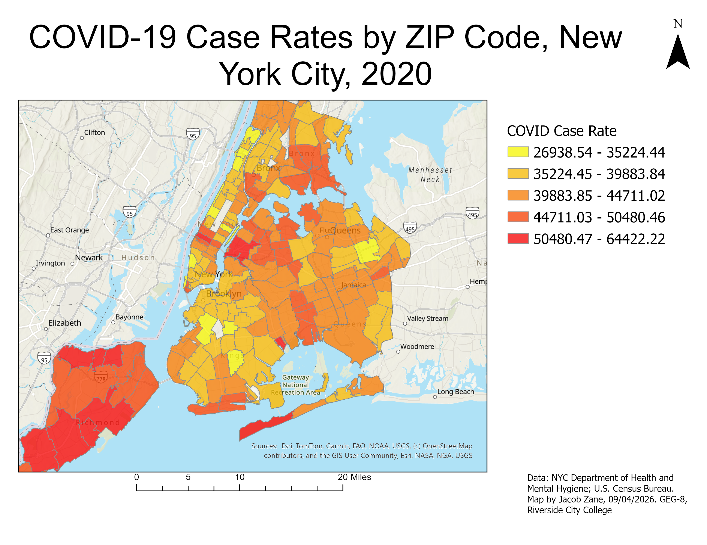

# Jacob Zane

I am studying Emergency Management, with an interest in how Geographic Information Systems (GIS) can support public safety and emergency response. I want to use GIS to better understand how emergencies affect communities and how geographic data can help agencies make informed decisions during disasters and other emergencies.

---

## 2018 Kilauea Volcanic Eruption, Hawaii

**Question:** How did the 2018 Kilauea volcanic eruption change the surrounding landscape, and what areas were affected by the lava flows?

**Data:** I used Landsat 8 satellite imagery provided by the U.S. Geological Survey (USGS), along with the 2018 Kilauea Lava Flow Extents dataset provided by Esri through Learn ArcGIS. These datasets show the landscape surrounding the volcano and the extent of lava flows during the 2018 eruption.

**Method:** I used ArcGIS to create a swipe map comparing satellite imagery of the same geographic area from two different periods. By placing the images on top of each other and using the swipe tool, viewers can compare the landscape before and after the eruption. This makes it easier to identify the visible changes caused by volcanic activity.

**A design choice I made and why:** I chose a swipe map instead of displaying two separate maps because it allows viewers to compare the same location without having to look back and forth between images. I also included a red outline to identify the area affected by the lava flows. This makes it easier to understand the geographic extent of the eruption and how the surrounding landscape changed.

**A limitation of this map:** Although the map shows changes in the landscape, it does not explain the full extent of the damage caused by the eruption. It cannot tell viewers how many homes were destroyed, how many residents were displaced, or the financial cost of the disaster. Additional data would be needed to evaluate those impacts.

---

## COVID-19 Case Rates by ZIP Code, New York City, 2020

**Question:** How did COVID-19 case rates vary between ZIP codes throughout New York City in 2020, and which areas experienced higher reported rates?

**Data:** I used COVID-19 case rate data published by the New York City Department of Health and Mental Hygiene in 2020, along with geographic boundary data from the U.S. Census Bureau. The data represents reported COVID-19 case rates across different ZIP code areas throughout New York City.

**Method:** I used ArcGIS Pro to create a choropleth map displaying COVID-19 case rates across New York City ZIP code areas. After combining the geographic boundaries with the COVID-19 data, I classified the case rates into five categories and assigned different colors to represent their values. This allows viewers to identify areas with relatively higher and lower reported case rates.

**A design choice I made and why:** I used a graduated color scheme ranging from yellow to red, with yellow representing the lowest case rates and red representing the highest. I chose this because the progression in colors makes differences between areas easier to recognize. I also included a legend, scale bar, and north arrow so the map could be understood without additional explanation.

**A limitation of this map:** The map only represents reported COVID-19 case rates and does not account for people who were infected but never tested or reported. It also does not explain why certain ZIP codes experienced higher rates. Factors such as population density, access to healthcare, and testing availability may have influenced the patterns shown.

---

## Data sources

- Landsat 8 Satellite Imagery, U.S. Geological Survey (USGS), 2018. https://www.usgs.gov/landsat-missions
- Kilauea 2018 Lava Flow Extents, Esri Learn ArcGIS, 2018. https://learn.arcgis.com/
- COVID-19 Case Rates by ZIP Code, NYC Department of Health and Mental Hygiene, 2020. https://github.com/nychealth/coronavirus-data/blob/master/trends/caserate-by-modzcta.csv
- ZIP Code Tabulation Area Boundaries, U.S. Census Bureau. https://www.census.gov/geographies/mapping-files/time-series/geo/tiger-line-file.html

---

## Where this is going

As I continue developing my GIS skills, I plan to add additional maps that focus on emergency management, natural disasters, and public safety. I am particularly interested in how GIS can help emergency management agencies assess risks, identify vulnerable communities, and allocate resources during emergencies. By the end of the semester, I want this portfolio to demonstrate my ability to create maps that are not only visually understandable but also useful for interpreting geographic data and supporting decisions in emergency management.
## Where this is going

As I continue developing my GIS skills, I plan to add additional maps that focus on emergency management, natural disasters, and public safety. I am particularly interested in how GIS can help emergency management agencies assess risks, identify vulnerable communities, and allocate resources during emergencies. By the end of the semester, I want this portfolio to demonstrate my ability to create maps that are not only visually understandable but also useful for interpreting geographic data and supporting decisions in emergency management.
